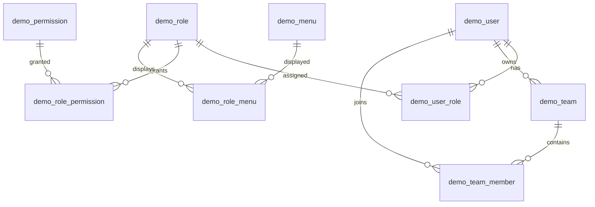

# 用户相关数据库设计

本稿保留用户、系统功能权限、导航和团队成员的数据设计基线。配套 `user-schema.sql` 是空库建表参考；当前已完成 MySQL 落地及代码实现，实际功能、迁移入口和测试结果以[用户模块交付说明](../zh-CN/user-module-completion.md)为准。本文后续“接入动作”记录的是设计阶段的变更清单。

## 1. 表范围与关系

沿用现有 `demo_` 前缀和七张 RBAC 表的职责，新增团队、团队成员两张表，共九张。用户可同时拥有多个系统角色、加入多个团队。

| 表 | 用途 | 非空字段 | 唯一约束 |
| --- | --- | --- | --- |
| `demo_user` | 账户、个人资料、界面偏好 | `id`、`login` | `login`；非空 `email` |
| `demo_role` | 系统功能角色 | `id`、`code`、`name` | `code` |
| `demo_permission` | 功能权限目录 | `id`、`code`、`name` | `code` |
| `demo_menu` | 前端导航菜单 | `id`、`name` | 非空 `path` |
| `demo_user_role` | 用户拥有的系统角色 | `user_id`、`role_id` | 二者组成主键 |
| `demo_role_permission` | 系统角色拥有的功能权限 | `role_id`、`permission_id` | 二者组成主键 |
| `demo_role_menu` | 系统角色可见的菜单 | `role_id`、`menu_id` | 二者组成主键 |
| `demo_team` | 资源共享团队 | `id`、`name`、`owner_user_id` | 无额外唯一字段 |
| `demo_team_member` | 用户在团队中的身份与当前状态 | `team_id`、`user_id` | 二者组成主键 |

上述关系为逻辑关系。DDL 暂不声明物理外键，由服务层在事务中检查引用、团队负责人和成员状态。建表稿不包含初始账户和角色授权，避免创建默认管理员或默认密码。

## 2. 字段和空值规则

除表中列明的关键字段外，所有列都显式允许 NULL，包括状态、排序、操作人和时间。默认值只在省略字段时提供初值，不限制显式写入 NULL。

- 必填字符串仍需由应用层校验去除首尾空格后非空；`NOT NULL` 不能阻止空字符串。
- `login` 用作登录身份，必填且唯一；`display_name` 是可空的显示名称，未填时显示登录账号。
- 邮箱可空，填写时保持唯一，延续已有按邮箱查找单个用户的接口语义。可选邮箱、菜单路径的空字符串统一转 NULL，避免空字符串触发唯一冲突。
- `organization`、`department` 是资料文本，相同单位名称不产生团队权限。
- 根菜单、根权限的 `parent_id` 为 NULL；编辑树时检查父节点存在、禁止自指和循环。
- 本稿沿用普通 BIGINT，与现有 Java Long 类型一致。单实体表使用自增主键；关联表保留复合主键，防止重复授权和重复成员。
- 账号、角色编码、权限编码按大小写不敏感处理。应用层统一账号大小写和首尾空白；权限编码使用统一小写形式。
- 数据库存储时间统一按 UTC 写入和读取，前端按用户时区展示；连接时区也设为 UTC。DATETIME 本身不携带时区信息。

允许 NULL 不代表授予默认权限：账户仅 `status=1` 可登录；角色、权限、团队仅 `status=1` 参与授权；菜单仅 `status=1` 展示。NULL、未知状态或未知成员角色都不授予权限。

## 3. 用户字段字典

| 字段 | 类型 | 可空 | 含义 |
| --- | --- | --- | --- |
| `id` | BIGINT | 否 | 内部用户身份，业务资源和历史记录引用它 |
| `login` | VARCHAR(64) | 否 | 唯一登录账号 |
| `display_name` | VARCHAR(100) | 是 | 显示名称 |
| `password_hash` | VARCHAR(255) | 是 | 密码哈希；无本地密码时保持 NULL |
| `email` | VARCHAR(254) | 是 | 唯一可选邮箱 |
| `phone` | VARCHAR(32) | 是 | 联系电话，本期不作为登录标识 |
| `avatar_url` | VARCHAR(1024) | 是 | 头像地址或文件引用 |
| `organization` | VARCHAR(200) | 是 | 所属单位 |
| `department` | VARCHAR(200) | 是 | 所属部门 |
| `status` | TINYINT | 是 | 0禁用或待启用，1启用，2锁定；默认0 |
| `lang_key` | VARCHAR(20) | 是 | 语言偏好 |
| `preferences` | JSON | 是 | 非敏感界面偏好，例如高级配置展开状态 |
| `last_login_at` | DATETIME | 是 | 最近成功登录时间 |
| `last_login_ip` | VARCHAR(45) | 是 | 最近成功登录IP |
| `remark` | VARCHAR(1000) | 是 | 备注 |
| `created_by` / `updated_by` | BIGINT | 是 | 操作人用户ID |
| `created_at` / `updated_at` | DATETIME | 是 | 创建与最后修改时间 |

仅存带盐的自适应密码哈希，不存明文或可解密密码。密码哈希为 NULL 时，本地密码登录不可用，不解释为空密码。本稿不把邮箱验证、密码重置和单点登录所需数据提前并入用户表；实现这些功能时再增加短期令牌或外部身份表。

`preferences` 只保存个人界面设置，不保存模型 Key、方法参数或权限。偏好中的“展开高级配置”仅影响展示。

## 4. 角色、权限、菜单字段

三类目录表统一包含可空的 `created_by`、`updated_by`、`created_at`、`updated_at`。详细长度、索引和字段注释以配套 SQL 为准。

| 表 | 其余字段 | 解释 |
| --- | --- | --- |
| `demo_role` | `code`、`name`、`description`、`status`、`sort` | 稳定编码和显示名称分开，角色名称可改 |
| `demo_permission` | `code`、`name`、`type`、`parent_id`、`description`、`status`、`sort` | type=1页面、2操作，仅用于分类；权限编码用于后端鉴权 |
| `demo_menu` | `name`、`path`、`icon`、`parent_id`、`component`、`sort`、`status` | path 可空以支持纯目录；菜单展示不替代接口权限检查 |

三张角色关联表均以关联双方 ID 组成主键，另保存可空的 `created_by`、`created_at`。撤销授权删除关联，不增加一套可空的关联启用状态。

权限父子关系仅用于组织目录，不隐含父权限自动授予所有子权限；后端按具体权限编码鉴权。

初始角色建议只设置 `ADMIN`（系统管理）和 `USER`（普通使用），具体权限通过 `demo_role_permission` 分配。应用客户和算法开发者可使用相同页面；不设置固定的“客户不能调试”规则。系统管理员不是默认的数据全量读取角色；如果以后需要跨用户读取资源，应增加明确的管理权限。

后续可采用的权限编码示例：

| 范围 | 编码示例 |
| --- | --- |
| 用户与团队管理 | `user:manage`、`role:manage`、`team:create` |
| 方法 | `method:read`、`method:create`、`method:edit`、`method:version:create` |
| 知识库 | `knowledge:read`、`knowledge:edit`、`knowledge:version:create` |
| 单篇调试 | `debug:run`、`debug:history:read` |
| 批量识别 | `batch:create`、`batch:read`、`batch:export`、`batch:retry` |
| 模型连接 | `connection:use`、`connection:manage` |

这些是稳定的功能能力标识，不包含具体资源 ID。各接口是否需要某项权限，在后续服务实现中固定；本次不初始化授权数据。

## 5. 团队与成员字段

| 表 | 字段 | 含义 |
| --- | --- | --- |
| `demo_team` | `id`、`name` | 团队身份；名称允许重名 |
| `demo_team` | `owner_user_id` | 唯一负责人，必填 |
| `demo_team` | `description`、`status` | 可空说明；0停用、1启用，默认1 |
| `demo_team_member` | `team_id`、`user_id` | 一个用户在一个团队中最多一条当前关系 |
| `demo_team_member` | `member_role` | 可空；`admin` 为团队管理员，`member` 为普通成员，默认 member |
| `demo_team_member` | `status` | 可空；0退出或停用，1有效，默认1 |
| `demo_team_member` | `joined_at`、`left_at` | 可空；最近加入／退出时间 |

两表均保存可空的操作人和创建／修改时间。`owner_user_id` 是负责人身份的唯一依据，不再给 `member_role` 增加 owner 枚举。

服务层必须在事务中执行：

1. 创建团队并写入负责人的有效成员关系，其成员角色为 member 或 admin。
2. 转移负责人前，确认目标账户启用且是有效成员，随后更新 owner_user_id。
3. 负责人不能直接退出或被移除，须先转移负责人或停用团队。
4. 退出团队时设 status=0 并写入 left_at；重新加入恢复同一关系，更新 joined_at、清空 left_at，不自动恢复过往管理员身份。
5. 账户停用后，即使成员关系仍有效，也不参与授权。负责人账户停用时先完成团队转交或团队停用。

成员表只保存当前关系和最近一次加入／退出时间；不声称保存完整成员变更历史。未来需要完整审计时，增加通用审计事件表。

## 6. 与后续业务资源的衔接

功能权限检查与资源权限检查分别进行：用户既要拥有操作能力，也要对目标对象有对应访问权限。

方法、知识库、模型连接等资源后续保存 `owner_user_id`、`visibility`（private/team/builtin）和可空的 `team_id`。team 可见资源要求 team_id 有值；非 team 资源则为空。需要多个团队或指定用户共享时，再增加资源授权关系，避免把任意资源 ID 写进系统角色表。

有效团队成员默认只能读取／使用明确共享给团队的资源。团队管理员管理成员，不自动获得所有成员个人资源的读取或编辑权限。团队资源编辑、版本发布和模型连接管理需资源所有者或后续明确的编辑授权；内置资源发布也需明确的发布授权。

运行、任务、版本记录保存执行人／保存人的内部用户 ID；重要历史展示可另外保存当时的显示名称快照。改名不改变用户身份，团队退出不改变历史执行人。账户和团队以停用为主，不直接物理删除仍被业务记录引用的实体；角色／权限删除前必须处理关联记录。

## 7. 设计阶段差异与实际接入

设计时 `1.0.0/changes.sql` 已有七张 RBAC 表，以下记录当时发现的字段差异和接入要求：

| 现状 | 本设计确定的口径 | 后续接入动作 |
| --- | --- | --- |
| 旧 DDL 与 UserMapper.xml 使用 password，UserDO 使用 password_hash | password_hash | 统一 DDL、DO、XML、DTO转换；核实存量值是否为哈希后迁移，不能直接假定 |
| UserDO 同时有 activated、locked 和 status，旧 DDL 无前两列 | 只保留 status | 删除重复状态映射，统一状态判断 |
| UserDO 的时间映射为 created_date、last_modified_date，旧 DDL／XML 为 created_at、updated_at | created_at、updated_at | 统一 DO 和 XML 映射 |
| UserDO 有激活、重置字段，旧 DDL 无对应列 | 本期不启用这些流程 | 移除未实现字段映射，后续用独立令牌表扩展 |
| 旧邮箱和密码强制非空，账号长度20 | 可空邮箱、可空哈希、账号长度64 | 同步接口校验；创建普通用户时至少填写 login |
| 根节点默认0 | NULL表示根节点 | 同步菜单／权限树构建代码与存量根节点数据 |
| 七张旧表无团队数据 | 增加团队与成员 | 增加对应服务、事务校验和资源范围判断 |
| 现有删除用户流程会删除账户及关联 | 有业务引用时停用账户 | 接入前调整删除逻辑，保留历史引用 |

实际 HTTP 更新接口已使用 JSON 字段存在性区分“字段未提交”和“显式清空”，通过参数化 JDBC 保存 NULL。保留的旧 Java 服务适配器继续采用其原有的未填写字段忽略语义；新的 HTTP 接口不依赖旧 MapStruct 更新逻辑。

实际接入使用独立 MySQL 库、新 Liquibase 变更集和统一后的用户字段映射；没有重写旧 1.0.0 迁移。配套 user-schema.sql 仍仅作为空库建表参考，不是对任意既有库的无损升级脚本。启动、接口及验收结果见当前交付说明。

本期不增加具体资源授权表、登录会话表、邀请表、登录流水表、要素识别表或交叉度计算表。需要对应功能时，基于稳定的 user_id、team_id 和资源 ID 增加独立关系即可。
