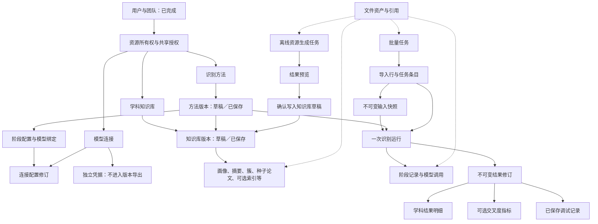

# 后续业务数据库设计与实施计划

日期：2026-11-11。适用项目：学科交叉算法调试系统。

本文承接已完成的用户、权限、菜单和团队模块，规划其余业务需要持久化的数据、对象关联、实施顺序和验收要求。本轮仅形成计划，不执行建表或业务代码改造。下列名称是建议的逻辑表名，正式字段、类型和拆表数量在逐模块设计时确定，不要求一次性建齐。

## 1. 已确认的边界

| 项目 | 本计划采用的口径 |
| --- | --- |
| 用户与团队 | 复用现有九张表，不另建用户或团队体系 |
| 数据库 | 继续使用业务库 `direction_classifier` 和独立测试库 `direction_classifier_test`；业务模块不各自另建一个物理数据库 |
| 业务入口 | 识别方法、学科知识库、单篇调试、批量识别、设置／模型连接 |
| 识别主流程 | 输入解析 → 簇路由 → 学科召回 → 独立精判 → 后处理 → 学科结果 |
| 交叉度 | 支持外部返回／导入、存储、状态、关联、展示和导出；不实现计算公式，不强制保存 N、D、K |
| 研究要素 | 不实现抽取、句子定位、要素学科识别和人工改句；通过阶段及结果结构预留扩展 |
| 版本 | 草稿可编辑，保存版本后内容固定；运行引用具体版本，不引用“最新版本”这一动态概念 |
| 字段空值 | 除主键、关键标识、构成关系所必需的 ID 外，普通字段尽量允许 NULL；发布和执行条件由业务层校验 |
| Windows 文件访问 | `LAPTOP-BDKBMPCD\JHY` 对项目文件保持完全控制；新增文件继承，受保护文件也显式保留该权限 |

学科画像中的“核心任务、边缘任务、交叉任务、学科区分规则”仍属于知识库内容，需要保存。它们与本期暂缓的“论文研究要素抽取”不是同一对象。

## 2. 总体关联

系统围绕“已保存的方法版本”组织执行。方法引用已保存的知识库版本，并为阶段绑定明确的模型连接配置修订。单篇与批量共同使用同一套运行、阶段和结果数据。

需要固定的关键关系：

1. 一个方法有多个版本；“最新保存版本”和“默认使用版本”分别记录。
2. 一个方法版本引用一套明确的知识库版本；使用的阶段模型配置也要固定。
3. 一个知识库版本包含该版本实际拥有的资源集合，不能只保存原目录路径。
4. 一个运行固定输入、方法版本、知识版本、实际执行配置和算法实现标识。
5. 一个批量任务包含多个输入条目，每次处理或重试都关联独立运行。
6. 历史调试、批量结果和导出固定到具体结果修订；后续补充指标或重跑不覆盖原快照。

## 3. 共同基础：文件、所有权与资源授权

### 3.1 需要保存的数据

| 建议表 | 内容 | 关联方式 |
| --- | --- | --- |
| `demo_file_asset` | 原文件名、存储标识、类型、大小、内容哈希、用途、状态、上传人和时间 | 供上传文件、原始知识文件、索引、调用附件和导出文件引用 |
| `demo_asset_reference` | 文件被哪个业务对象、哪个版本、以何种用途引用 | `asset_id` + 受控的业务类型与对象 ID，支撑引用检查和文件清理 |
| `demo_resource_grant` | 向指定用户或团队授予某资源的读取、使用、编辑、发布等能力 | 资源类型／资源 ID + 授权对象类型／ID + 能力 |

资源主对象保存 `owner_user_id`、`visibility` 和可空的 `team_id`，直接关联已实现的 `demo_user`、`demo_team`。个人、团队共享、内置模板是可见范围，不另建三套业务表。

### 3.2 注意事项

- 功能权限与对象权限同时检查。例如有 `method:edit`，仍需具备目标方法的编辑权。
- 有效团队成员默认只能读取／使用明确共享的资源；团队管理员不自动取得成员个人资源的访问权。
- 系统管理员也不因角色名称自动获得所有业务内容的读取权；全局资源管理须有明确能力定义。
- 团队共享要求目标团队有效，且 `team_id` 明确；NULL 或不完整的授权数据不授予访问权。
- 模板／共享方法复制后产生自己的资源身份，记录复制来源版本，不能继续共用可编辑草稿。
- 资源授权的类型和能力使用白名单，不允许由请求指定任意数据库表名。
- 文件使用内部资产 ID 访问，通过业务权限下载；不直接将本地绝对路径作为公共下载地址。
- 上传先暂存、校验后标记就绪；数据库提交失败应保留可清理的暂存状态，不能出现“记录成功但文件不存在”。
- 被版本、历史或任务引用的文件不能直接删除。数据库和文件存储需要配套备份，不能只备份其中之一。

## 4. 设置／模型连接

### 4.1 数据对象

| 建议表 | 主要数据 |
| --- | --- |
| `demo_model_connection` | 连接名称、说明、所有者、共享范围、启停状态、当前配置修订与凭据引用 |
| `demo_model_connection_revision` | 协议、服务地址或地址列表、模型名称、对话／向量用途、配置修订号与创建信息 |
| `demo_model_credential` | 加密凭据或密钥引用、密钥版本、更新信息；不用于业务导出 |
| `demo_model_connection_test` | 测试的配置修订、连通状态、可调用状态、耗时、脱敏示例、错误和时间 |

关联：连接身份 1:N 配置修订；方法阶段绑定具体配置修订；连接维护当前可用凭据。调用记录保留实际使用的公开配置快照。

### 4.2 规则

- 更换 Key 不要求创建方法新版本。更换模型名称、协议或服务配置应形成新的配置修订；已保存方法继续引用原修订。
- Key 不进入方法、知识库、运行快照和普通导出；日志和错误内容也需脱敏。
- 若采用加密存储，解密主密钥不与密文放在同一业务数据库；其本地文件同样保留 JHY 的完全控制权限。
- 停用连接不删除历史依据；再次执行仍需检查连接是否可用、操作者是否有使用权限。
- 温度、输出长度、召回数量、提示词属于方法阶段；连接测试采用固定测试请求。
- 向量索引须关联实际编码模型配置和向量空间信息。仅模型显示名称相同，不足以证明索引兼容。

## 5. 学科知识库

### 5.1 数据对象

| 建议表 | 主要数据 | 关键关联 |
| --- | --- | --- |
| `demo_taxonomy` | 学科体系标识、名称、来源、说明 | 区分 moe、wos_ssci、wos_scie 等体系 |
| `demo_discipline` | 稳定内部学科 ID、所属体系、原始代码、规范化代码 | 同体系内明确代码唯一性，不跨体系混用 |
| `demo_knowledge_base` | 名称、说明、所有者、共享范围、体系、草稿及默认／最新版本指针 | 1:N 知识库版本 |
| `demo_knowledge_version` | 版本号、状态、来源版本、说明、保存人、资源清单、校验摘要、内容结构版本 | 属于一个知识库 |
| `demo_knowledge_discipline` | 版本内学科代码／名称快照、原始定义、完整画像 JSON、算法实际使用文本、来源与哈希 | 知识版本 + 学科 ID |
| `demo_knowledge_summary` | 召回摘要、关键词、来源画像哈希、生成依据、待更新状态 | 同知识版本内的学科画像 |
| `demo_knowledge_cluster` | 簇代码、名称、描述、关键词、顺序 | 属于具体知识版本 |
| `demo_knowledge_cluster_member` | 簇与学科成员关系 | 学科必须存在于同一知识版本 |
| `demo_knowledge_seed_paper` | 种子论文标题、摘要、DOI、作者、出版信息、来源编号、原始记录与来源文件 | 属于具体知识版本 |
| `demo_seed_paper_discipline` | 种子论文与学科关系、是否参与生成 | 支持一篇种子论文用于多个学科 |
| `demo_knowledge_index`（按策略启用） | 索引类型、来源资源哈希、编码模型修订、维度、构建规则、条目数、文件资产与状态 | 知识版本 + 模型配置 + 文件资产 |

相似度表本期可作为可选文件资产挂入知识版本资源清单，保存来源、说明和适用范围。不把逐学科对编辑／检索、覆盖率计算或差异度计算作为核心识别依赖；确需实现这些管理操作时，再设计学科对明细表。

### 5.2 版本的实现建议

第一期优先采用“知识版本 + 版本内资源行”的直接快照方式：从旧版本创建草稿时复制资源数据；大文件可共享不可变资产引用。暂不开发复杂的资源增量版本合并机制。

- 草稿允许资源不完整；记录草稿修订号，支持并发编辑检查。
- 保存版本时，在事务内固定资源集合、清单及校验结果，之后禁止修改这些内容。
- 学科名称与代码在版本资源中保留快照；全局目录后来改名，不改变历史画像和运行解释。
- 画像的原文件版本字段、画像 JSON 结构版本和系统知识库发布版本分别保存，不能相互替代。
- 摘要记录来源画像哈希。画像修改后提示待更新，不自动重新生成摘要或调整簇成员。
- 资源完整性按方法策略检查：LLM 分层召回不要求向量索引；没有交叉度计算也不要求相似度表完整。
- 知识库发布新版本后，历史方法不自动升级；需要编辑方法草稿并明确选择新知识版本。

## 6. 识别方法与阶段配置

| 建议表 | 主要数据 |
| --- | --- |
| `demo_method` | 方法名称、说明、所有者、共享范围、归档状态、默认／最新保存版本、当前草稿、复制来源 |
| `demo_method_version` | 版本号、状态、来源版本、说明、保存信息、知识版本引用、流程结构、配置结构版本、算法实现标识 |
| `demo_method_stage` | 所属方法版本、稳定阶段代码、启用状态、策略、基础／高级配置 JSON、提示词内容、调用参数、校验结果 |
| `demo_method_stage_model` | 阶段使用的模型配置修订及用途，如路由、召回、精判、向量编码 |

推荐使用“明确的关联字段 + 有结构校验的配置 JSON”，避免将每个算法参数都拆成数据库列。配置字段及可编辑项由已实现的策略定义。

关键规则：

1. 已保存方法版本引用已保存知识版本，执行时不能解析成当前最新知识版本。
2. 阶段可以有不同模型；同一阶段也可按用途绑定多个模型，不设计笼统的全局当前模型。
3. LLM 召回本身需要模型绑定，不能只给路由和精判配置模型。
4. 发布时固定实际提示词和生效默认参数；只存提示词文件名或模板名称不足以复现依据。
5. 检查必需变量、数量上下限、已实现策略、模型用途、知识范围及索引兼容性。
6. 草稿允许知识版本或模型暂缺；缺失配置的草稿不能作为正常运行依据。
7. 同一方法的默认版本不一定是最新版本。默认版本调整不能修改已有运行记录。
8. 第一阶段不建立研究要素节点的专用数据表，也不把交叉度公式参数放入必填配置。

## 7. 统一识别运行、单篇调试与结果

### 7.1 数据对象

| 建议表 | 主要数据 | 说明 |
| --- | --- | --- |
| `demo_input_snapshot` | 原始输入、标准字段、内容类型、外部编号、来源文件／工作表／行号、内容哈希、补充 JSON | 输入编辑后产生新快照，不覆盖原内容 |
| `demo_recognition_run` | 输入快照、方法版本、知识版本、实际配置、发起人、来源类型、父运行、起始阶段、状态、时间、错误、当前结果指针 | 单篇与批量共用 |
| `demo_run_stage` | 阶段代码、状态、输入／输出快照或资产引用、耗时、错误、复用来源阶段 | 一个运行可含多个阶段 |
| `demo_model_call` | 阶段或离线生成项来源、模型配置快照、脱敏实际请求、响应、解析结果、耗时、调用／重试序号 | 一个阶段可含多个并发候选调用和多次重试 |
| `demo_run_candidate` | 候选学科、召回来源、名次、等级、分数及分数类型、补足／人工加入标记 | 候选数量不固定为 Top5 |
| `demo_candidate_judgment` | 候选的精判等级、理由、匹配任务／特征、边界解释、置信信息、失败信息 | 与召回信息分别保存 |
| `demo_run_result` | 不可变结果修订、主学科、简要说明、依据、来源修订与结果哈希 | 保存原结果及后续明确生成的修订 |
| `demo_result_discipline` | 每个结果修订的学科、排名、最终等级、原始等级／名次、后处理规则和原因 | 用明细行，不采用 rank_1～rank_20 横向列 |
| `demo_result_metric` | 指标代码、值、状态、来源、方法标识／版本、时间、可选详情 JSON | 用于 ICI 等可选指标 |
| `demo_run_intervention` | 干预类型、目标、修改前后内容、操作者、时间、影响阶段、来源运行 | 本期支持加候选等实际已实现的干预 |
| `demo_debug_record` | 已保存调试记录名称、运行 ID、固定结果修订、阶段快照清单、保存人和时间 | 与临时执行记录区分 |

### 7.2 执行与历史规则

- 运行开始时固定版本 ID、配置和资源哈希。运行过程不得重新读取“最新默认版本”。
- 解析／截断后的实际文本保存在阶段结果，不反向覆盖原始输入快照。
- 终态运行及其结果保持固定。重新运行、失败阶段重试、从选中阶段续跑、人工干预均创建关联的新运行。
- 子运行仅在输入、方法和资源依据一致时，才可复用前置阶段；记录来源阶段，不能把旧输出伪装成新执行。
- 干预后的当前调试分支将受影响阶段标为待重算；原算法运行和已保存历史不因此失效或被覆盖。
- 调用重试逐次保留，不只保存最终一次响应。协议层重试与业务层重新运行分别记录。
- 精判失败与“基本不相关”分别表示，不能把错误转成低相关。是否允许部分结果须由方法策略明确规定。
- 调试历史由用户保存形成可见记录；未保存执行仍应有必要的持久化状态，以便故障定位和任务恢复。
- 历史展示引用具体结果修订和阶段清单，不能通过运行的可变“当前结果指针”动态获取历史内容。

### 7.3 交叉度仅做结果接入

`demo_result_metric` 至少设计以下逻辑字段：所属结果修订、指标代码（如 ICI）、数值、状态、来源、计算方法标识／版本、生成时间、接收时间、错误说明及可选详情 JSON。

- 未提供指标时保持 NULL，并显示“未提供”；数值0是有效结果，不能代表未计算。
- 不预设数值必须位于0到1之间，不要求返回 N、D、K。
- 学科识别成功但没有交叉度，仍算识别成功；指标失败单独表达。
- 交叉度必须关联实际使用的学科结果修订，不能只按论文标题、DOI或外部编号回填。
- 后续外部服务补充指标时，产生新的结果修订并明确采用；原保存记录及既有导出仍固定原修订。
- 人工调整或重算学科结果后，旧指标只属于旧结果；新结果的指标等待重新提供，不能直接复制为有效值。
- 四类研究要素与句子选择不进入这些表的必填字段。

## 8. 批量识别

| 建议表 | 主要数据 |
| --- | --- |
| `demo_batch_task` | 任务名称、提交人、固定方法／知识版本、当前导入、任务状态、提交／开始／完成时间、数量与进度摘要 |
| `demo_batch_import` | 上传文件资产、工作表、字段映射、校验规则、检查状态与统计、异常清单资产 |
| `demo_batch_row` | 原始行、来源行号、外部编号／业务键、映射后输入、校验问题、是否明确跳过 |
| `demo_batch_item` | 提交执行的行、输入快照、执行状态、当前运行及固定结果修订、尝试次数、失败原因、领取／租约信息 |

关联：任务 1:N 导入检查；选定导入 1:N 原始行；有效提交行产生任务条目；一个条目可对应多次运行，运行通过条目 ID 与父运行保留完整尝试关系。

注意事项：

1. “选择方法—上传检查—确认提交”阶段允许草稿；提交执行时固定版本和选定导入，不再替换原文件与映射。
2. 重新上传产生新的导入检查记录，不覆盖旧文件或静默丢掉异常行。
3. 区分上传总行数、有效数、异常数、用户跳过数、提交数、成功数、失败数和待处理数。
4. 异常行导出与执行失败清单是不同数据，分别保留原因和来源位置。
5. 重试失败项产生新运行，保留旧错误；已成功条目不因重试而重新识别。
6. 任务进度以条目状态为依据；可缓存汇总，但不能只由页面累加成功数。
7. 提交幂等键防止重复点击建任务；条目领取令牌和租约防止多工作线程重复提交结果。
8. 网络失败后的外部请求可能已执行；恢复逻辑不能承诺绝对只调用一次，应保留请求尝试并防止重复采用结果。
9. 查看单条结果读取原快照；复制到单篇调试则新建输入／运行，并保留来源关系。
10. 导出记录固定所用结果修订及字段结构版本，避免日后补指标使旧导出依据改变。

执行层优先采用由本系统数据库管理任务和条目、调用算法单条接口的方式。若复用现有 Python 批量接口，需要另存远端任务 ID、分块与条目映射、轮询及失败信息；超过256条时明确分块。远端文件任务及7天保留期不能作为系统的长期业务历史。

## 9. 离线资源生成与可选索引

| 建议表 | 主要数据 |
| --- | --- |
| `demo_resource_generation_task` | 生成类型、目标知识草稿、发起人、输入资源清单／哈希、模板与规则、模型配置修订、参数、进度、写入状态 |
| `demo_resource_generation_item` | 单个学科或资源的输入、输出预览、失败与重试、结果资产、是否应用及应用时的草稿修订 |

模型调用可复用 `demo_model_call`，通过明确的在线阶段来源或离线生成项来源关联；必须校验来源类型和引用，不能使用任意表名作为执行目标。

- 生成配置独立于在线识别方法，不复用在线阶段的可变参数作为隐式默认。
- 生成完成只形成预览，不直接改已保存知识版本。
- 确认写入时检查目标仍为同一草稿、输入画像未改变；若依据变化则提示冲突并保留预览，不自动覆盖新编辑。
- 先支持画像／摘要／簇等实际需要的生成任务；种子论文内部抽取结果可原样作为生成附件保存，不建设在线研究要素识别模块。
- 向量策略需要时再实现索引构建和兼容性校验；FAISS等文件作为版本化资产保存，MySQL记录元数据，不在本阶段引入新的向量数据库。

## 10. 当前算法目录可复用的数据与限制

算法根目录：`D:\mine\study\WHU\Irlab\20251129学科交叉\20261015教育部接口开发\codes1026\xixi\irlab\学科交叉算法接口\direction-classifier`。

本次重新核对现用三套资源：

| 系统标识 | 画像目录 | 画像数 | 召回摘要数 | 簇数 |
| --- | --- | ---: | ---: | ---: |
| moe | `outputs/LLM_portraits` | 95 | 95 | 18 |
| wos_ssci | `outputs/LLM_portraits_wos_SSCI` | 58 | 58 | 14 |
| wos_scie | `outputs/LLM_portraits_wos_SCIE` | 178 | 178 | 31 |

这些是当前本地资源范围，不代表学科体系的完整官方目录。现用摘要与簇文件路径以 `api_core.py` 的 SYSTEMS 配置为入口。

| 来源 | 可参考的数据 | 使用注意 |
| --- | --- | --- |
| `outputs/LLM_portraits*` | 现用完整任务型画像与原始 JSON | 教育部使用 category_id／category_name，WOS文件可使用 discipline_code／discipline_name，需要导入适配 |
| `outputs/portraits`、`expanded_portraits` | 旧画像和种子扩充画像 | 与现用画像结构不同，单独标明结构及来源，不自动拼成同一知识版本 |
| `outputs/llm_hier_recall_cache*` | 摘要、关键词、簇和成员 | 文件名里的 sel173、c12不等于实际数量，导入时读取内容并校验 |
| `data/definitions*.xlsx`、WOS定义文件 | 学科代码、名称、定义和来源 | 体系及代码以文本保留，不能全局按整数处理 |
| `data/95个学科训练集（收集摘要版）.xlsx` | 种子论文与学科来源 | 此前已核实id跨学科重复，不能作系统主键 |
| `data/95个学科测试集（收集摘要版）.xlsx` | 输入与字段映射样本 | 同样不能直接将id当作全局唯一编号；学科标签不默认进入模型输入 |
| `固定小样本数据集.xlsx` | 召回、精判、排名和失败／尝试字段 | 横向排名列转换为明细记录，不能直接照搬为数据库列 |
| `outputs/indexes` | FAISS、画像元数据、关键词倒排文件 | 关联实际资源范围和编码模型，不通过后缀猜测兼容性 |
| `交叉度最新版本.csv` | 可选相似度原始资产 | 不把它误认为已计算好的论文 ICI；本期不据此实现计算 |
| `outputs/seed_elements` | 离线生成中间数据 | 可做附件参考，不据此增加本期在线要素模块 |
| `api_core.py` | 当前运行字段、召回与精判流程 | 现有接口不等于完整阶段调试接口，需要补配置传递与过程记录 |
| `api_tasks.py` | 任务状态、原输入、结果和错误结构 | 当前批量上限256，结束任务默认保留7天；不能直接替代本系统任务库 |
| 原 `db.py` | 画像、索引文本和识别结果的早期字段 | 缺少本系统的完整版本、资源授权和运行关系，不直接拿来初始化业务库 |

导入历史结果时，只保存能核实的依据。缺少当时的方法版本、模型或提示词时标记“历史导入／依据不完整”，不补造版本，也不默认绑定当前版本。

## 11. 跨模块必须统一的规则

### 11.1 主键、字段与状态

- 内部主键与原始数据编号分开。DOI、标题、论文id、学科名称、文件名均不能代替全局内部主键。
- 学科身份至少由体系和稳定内部 ID 区分；`0101`、`714`、`SSCI-1`等原代码及规范化映射分别保留。
- 现有论文出版字段可能是201902等年月值，保存原值；需要规范年份时另存解析值，不静默截断。
- 批量外部编号重复检查限定在任务及业务键范围。现有按学科复用id的数据，应预览并明确选择“学科代码+id”等业务键，原编号不覆盖。
- 普通字段可空不等于记录可执行。未知状态、缺少发布依据、缺少授权均不按正常／成功处理。
- PATCH／PUT继续区分未提交和显式NULL；不使用忽略NULL的对象转换直接实现清空操作。
- 状态使用明确含义并在接口文档中统一，不混用“基本不相关”“精判失败”“缺失”“未提供”。

### 11.2 版本与并发

- 保存新版本是原子操作：资源清单、阶段配置、模型绑定和指针更新必须一致。
- 草稿使用修订号进行并发检查，避免两个页面最后保存者静默覆盖。
- 一个对象的当前草稿由明确指针控制，不仅靠可空状态字段判断；服务层防止产生多个互相冲突的活动草稿。
- 一旦版本已保存，写操作只能创建草稿或新版本，不能通过普通更新接口修改原内容。
- 更换默认版本、资源改名、用户改名或Key更新，不重写历史运行依据。
- 结果依据可追溯不代表LLM重跑必定逐字一致；实际输出、重试及调用配置仍需保存。

### 11.3 算法适配不能省略

当前 Python 实现使用模块级模型配置、固定资源路径及部分全局运行状态。数据库中增加方法配置后，还必须使实际算法按该方法执行。

1. 将知识版本导出成不可变运行资源包，记录文件清单与哈希；不覆盖现用 outputs 中的原始数据。
2. 为运行明确传递阶段策略、提示词、模型配置和资源包，而不是改写全局 .env、SYSTEMS或提示词变量。
3. 支持多方法并发，避免请求A的配置影响请求B。
4. 逐步补充实际阶段输入／输出、调用耗时和错误；缺少的过程信息显示未采集，不能用mock内容填充。
5. 尚未实现的策略不能保存成可执行版本，界面应明确其状态。

### 11.4 文件、凭据与历史访问

- 文件名仅作为展示信息，存储标识由服务器生成；检查路径、格式、大小与来源，不允许越出项目配置的存储目录。
- JHY的Windows完全控制权限与网页用户的资源授权分别落实，不能相互替代。
- 执行前检查用户、资源和连接的当前可用性；排队期间失去使用权时，应记录原因并停止相应新调用，不能换模型继续执行。
- 历史内容仍是当时的运行快照，但查看历史需要拥有该记录的访问权；原资源的直接访问继续按其当前授权判断。
- 调用附件可能包含论文全文和提示词，不能因文件ID可猜测而绕过权限下载。
- 归档、停用和物理删除分别处理；不对用户、知识库或方法执行会破坏历史引用的级联删除。

## 12. 建议实施顺序与完成标准

| 阶段 | 内容 | 依赖 | 完成标准 |
| --- | --- | --- | --- |
| P0 已完成 | 用户、角色、权限、菜单、团队、Windows文件权限 | 无 | 复用现有模块和已通过的验收，不重复建设 |
| P1 共同基础与模型连接 | 文件资产／引用、资源授权、连接／配置修订／凭据／测试 | P0 | 可上传和授权访问文件；连接可测试、停用；导出不含Key |
| P2 学科知识库 | 体系与学科、画像、摘要、簇、种子论文、草稿与版本、资源清单 | P1 | 可导入三套真实资源；范围和成员有效；编辑不影响已保存版本 |
| P3 识别方法 | 列表、复制、阶段配置、模型绑定、知识版本选择、发布和默认版本 | P1、P2 | 可形成可执行版本；配置校验通过；引用的版本固定 |
| P4 算法适配与单篇调试 | 不可变资源包、逐运行配置、输入与阶段、调用、候选精判、结果修订、指标接入、历史和干预 | P3 | 真实算法按指定方法执行；过程可查；历史不覆盖；ICI可空且不参与成功判定 |
| P5 批量识别 | 创建向导、导入检查、异常行、任务条目、队列恢复、失败重试、结果和导出 | P4 | 异常不丢失；失败可重试；成功项不重复；结果能打开快照或新建单篇调试 |
| P6 离线生成与按需策略 | 画像／摘要／簇生成预览、确认写草稿；需要时增加索引构建与向量策略 | P2、P4的调用记录能力 | 生成有依据和进度；不自动改版本；源草稿变化时能识别冲突 |
| P7 联合验收 | 权限、版本、文件一致性、并发、恢复、导出、真实页面与文档 | 前述已启用模块 | 逐项给出真实测试证据和已完成范围，保留暂未实现项 |

每一阶段按“详细表设计 → Liquibase变更集 → DAO／Manager／Service／API → 页面接入 → 真实MySQL功能测试 → 完成说明”交付。新增迁移应进入当前实际使用的MySQL变更链，不能只放进不会被当前配置加载的旧变更入口；不修改已执行变更集。

原有五个业务入口按模块逐步将 localStorage/mock 数据源替换为真实API。已接入的数据不能在请求失败时静默回退为模拟成功；尚未接入的页面继续明确标注演示状态。

## 13. 每个模块至少验证的场景

| 范围 | 验收重点 |
| --- | --- |
| 所有权与团队 | 个人、团队、内置范围；普通成员与编辑者；越权ID访问；成员退出和授权撤销 |
| 空值 | 仅关键字段创建；普通字段NULL；显式清空；未知状态拒绝执行；指标NULL与0区分 |
| 版本 | 历史不可修改；旧版本创建草稿；默认版本变化不影响旧任务；跨体系资源不能混用 |
| 连接与凭据 | 模型配置修订固定；Key更换不改方法；停用和失权阻止新调用；所有导出及日志不含凭据 |
| 知识库 | 重复代码、缺失画像、无效簇成员、摘要待更新、资源文件不匹配；无需相似度时不误拦截 |
| 单篇运行 | 真实输入／配置生效、原始与后处理结果分开、失败不是低相关、调用重试可查 |
| 干预和指标 | 原结果保留；新分支待重算；指标关联正确结果；后补指标不篡改已保存历史 |
| 批量 | 重复编号、缺失文本、无法解析行、异常导出、重复提交、重启恢复、并发领取、只重试失败项 |
| 离线生成 | 固定来源、结果预览、确认写入、草稿冲突、失败项和重试 |
| 文件与部署 | 文件缺失可定位；引用文件不误删；数据库和文件配套恢复；JHY实际可访问新生成文件 |

后续应先实施P1和P2：完成模型连接、文件与授权基础，并把现有真实学科知识资源纳入版本化管理，再形成可执行方法。这样单篇和批量功能都有明确、可追溯的运行依据。
