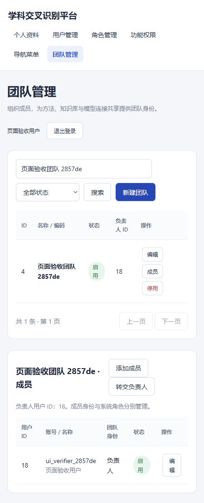

# 用户模块功能测试报告

测试日期：2026-11-11（北京时间）。测试对象为本次提交的 MySQL 用户、权限、菜单与团队模块。

## 1. 结果

| 检查 | 实测结果 |
| --- | --- |
| Maven 多模块编译与打包 | 七个模块全部成功 |
| 密码哈希单元测试 | 3个测试，通过；失败0、错误0 |
| 真实 HTTP / MySQL 功能验收 | 367项断言全部通过，约39.41秒 |
| 实际请求覆盖 | 172次常规 HTTP 请求校验，另含一组2个请求的并发转交测试 |
| MySQL 与应用重启后的持久化 | 16项断言全部通过 |
| 测试库结构核对 | 9张业务表、84列可空约束、13份已设密码的哈希格式、迁移历史与负责人成员关系均通过 |
| 正常业务库结构核对 | 9张业务表、84列可空约束、管理员密码哈希、迁移历史均通过 |
| 正常环境冒烟 | 管理员登录成功；角色有效；用户数1、团队数0；首页、管理入口、JS和CSS均返回200；健康状态UP |
| 浏览器验收 | 登录、资料保存、偏好保存、用户列表、用户表单、角色授权表单、团队创建、成员查看、普通成员操作限制通过 |
| JavaScript 静态检查 | 用户模块与主工作台脚本均通过 node --check |
| 变更格式检查 | git diff --check 通过 |
| Windows 文件访问修复 | JHY 对凭据文件完全控制；新文件继承完全控制；私有文件保留实际用户权限；已用 JHY 账号实际读取凭据及读写临时文件；凭据内容哈希未变 |

断言数包含 HTTP 状态、响应结构和业务结果的独立校验，不等同于367个独立测试用例。功能验收完成时间为 2026-11-11T04:41:50.073957+08:00；重启持久化验收完成时间为 2026-11-11T04:48:23.864384+08:00。

## 2. 已验证的业务链路

| 范围 | 覆盖场景 |
| --- | --- |
| 认证 | 未登录401；缺少CSRF令牌403；错误凭据401；跨源写请求403；正常登录与退出 |
| 会话 | Cookie实际含HttpOnly、SameSite=Strict；密码变更使当前及其他旧会话失效；锁定和停用后旧会话失效 |
| 用户数据 | 最小字段创建；可选字段为空；无本地密码不可登录；默认待启用；账号大小写归一与重复冲突；邮箱校验与唯一性 |
| 增量更新 | 显式NULL清空，未提交字段保留；偏好以JSON保存；普通用户不能自行修改状态或其他用户资料 |
| 输入校验 | 缺失／空账号、超长账号、未知字段、布尔状态、超大整数、错误分页、非法ID、非整数关联ID |
| 管理员保护 | 禁用最后管理员、清空其角色、停用／删除内置管理员角色、移除核心管理权限均被拒绝；事务回滚保持原授权 |
| 系统授权 | 用户获得角色后可访问管理功能；停用角色、NULL状态、撤销权限后立即失权；不存在的授权目标不产生部分替换 |
| 角色与菜单 | 角色删除清理关联；角色菜单分配生效；隐藏菜单即时消失；撤销菜单授权即时生效 |
| 树形目录 | 菜单自指、间接循环、权限循环、错误父节点、带子节点删除保护；根节点NULL与可空路由 |
| 团队隔离 | 创建时自动写负责人成员关系；未加入者不可读取团队或成员；普通列表不出现他人团队 |
| 团队角色 | 普通成员只读；团队管理员不能提权或处理负责人；负责人可增删成员、转交负责人 |
| 成员状态 | 移除和NULL状态即时失去访问；重新加入不恢复历史管理员权限 |
| 负责人约束 | 非成员不能接任；负责人不能直接退出；仍负责启用团队的账户不可停用；负责人停用时团队不能重新启用 |
| 并发 | 同一原负责人同时向两个成员转交：一个成功、另一个403；团队最终只有一个负责人 |
| 历史保留 | 删除用户实际停用，原记录仍可查询；团队停用保留成员关系 |
| 持久化 | 正常停止应用和MySQL，重新启动后，同一用户资料、团队、负责人及成员关系仍存在；迁移没有重复执行 |
| SQL与响应 | 搜索注入字符串按普通参数处理；用户接口与创建响应不暴露密码哈希 |

## 3. 浏览器验收

浏览器使用独立测试库中的临时验收账户，没有在正常业务库创建测试用户。

- 通过真实登录表单登录，读取个人资料。
- 通过表单保存单位与高级配置展示偏好，并在用户列表核实保存结果。
- 打开新建用户表单和角色权限选择表单，检查字段、可选状态及已有授权。
- 通过团队表单创建团队，检索后打开成员列表，确认负责人自动出现。
- 换用普通成员登录，确认仅显示个人资料和团队导航；团队行仅提供成员查看，未提供团队编辑和停用操作。
- 用户、角色与团队的权限变更由真实API验收；浏览器未用于修改真实账户密码或扩大真实人员权限。

临时浏览器验收管理员、普通成员和团队在验收后均已停用；正常业务库仅保留初始化管理员。页面截图来自临时测试环境。

## 4. 可复现证据

- 自动验收脚本：`scripts/test-users.py`。
- 结构核验程序：`scripts/UsersDatabaseCheck.java`。
- 单元测试：`system-direction-classifier-manager/src/test/java/cn/edu/whu/irlab/systemdirectionclassifier/manager/identity/PasswordHasherTest.java`。
- 本机完整HTTP结果：[users-test-results.json](../../logs/users-test-results.json)。
- 本机重启结果：[users-persistence-results.json](../../logs/users-persistence-results.json)。
- 本机正常环境冒烟：[users-normal-smoke.json](../../logs/users-normal-smoke.json)。
- 单元测试XML：manager模块 `target/surefire-reports/TEST-cn.edu.whu.irlab.systemdirectionclassifier.manager.identity.PasswordHasherTest.xml`。
- 构建日志：`logs/users-build.log`；数据库启动日志：`.tools/mysql/server.log`。

运行日志和target目录不进入Git，复现时会在本机重新生成。初始化与测试命令见[交付说明](user-module-completion.md)。

## 5. 本次验收的实际边界

这是本地单机、MySQL持久化用户模块的验收。未把邮件验证、找回密码、SSO、多实例共享会话、外网HTTPS部署、完整审计流水或大规模负载压测列为已完成。

登录限频的5分钟自然恢复和30分钟真实空闲超时没有等待完整时长进行实测；对应进程内计数和Servlet会话配置已实现。没有用一次成功请求替代对这些时间边界的测试声明。

算法运行、方法／知识库业务存储、模型调用、研究要素和交叉度计算均不在本报告完成范围内。
